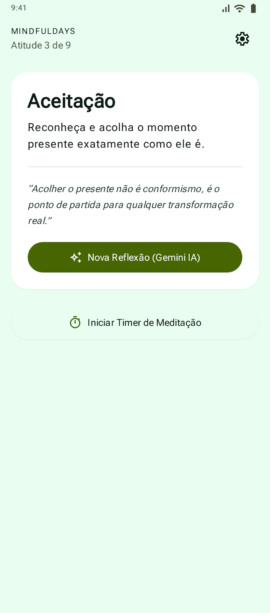
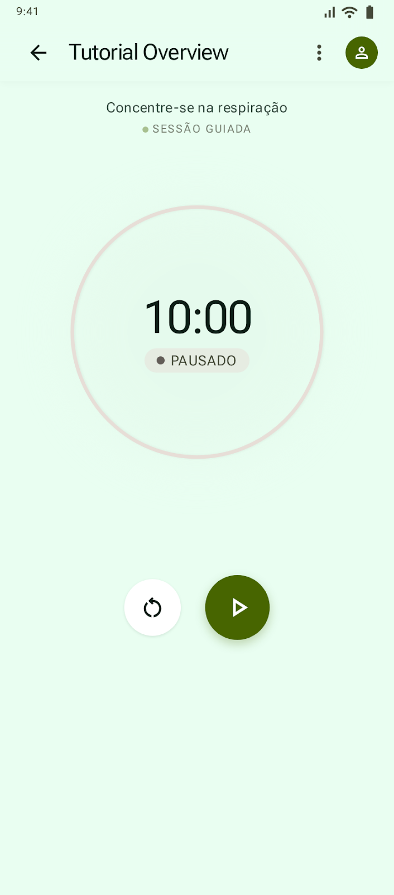
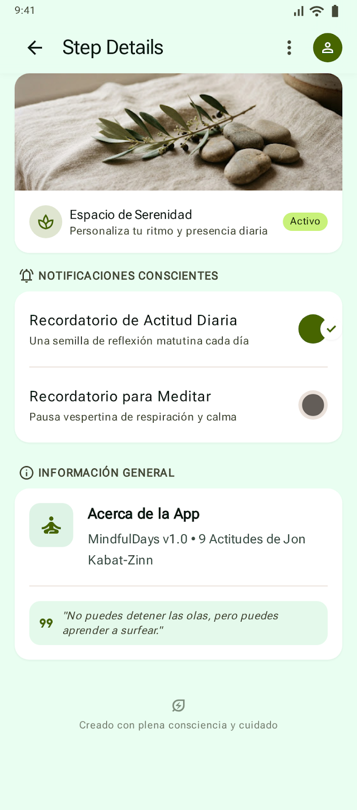

# 🧘 MindfulDays — Aplicativo Android de Mindfulness & IA

Bem-vindo ao repositório do aplicativo **MindfulDays**, desenvolvido durante o workshop prático de desenvolvimento Android com **Jetpack Compose**, **Material Design 3** e **Google Gemini API**.

---

## 📱 Protótipos de Interface (Google Stitch)

As telas do aplicativo foram concebidas no **[Google Stitch](https://stitch.withgoogle.com/)**, servindo como referência visual e design tokens para a implementação com Jetpack Compose:

| Tela Inicial (Home) | Timer de Meditação | Configurações |
| :---: | :---: | :---: |
|  |  |  |

---

## 🎯 Sobre o Aplicativo

O **MindfulDays** é um aplicativo minimalista e sereno de meditação guiada baseado nas **9 Atitudes de Mindfulness de Jon Kabat-Zinn**:
1. **Mente de Principiante** (*Beginner's Mind*)
2. **Não-Julgamento** (*Non-Judging*)
3. **Aceitação** (*Acceptance*)
4. **Desapego** (*Letting Go*)
5. **Confiança** (*Trust*)
6. **Não-Esforço** (*Non-Striving*)
7. **Paciência** (*Patience*)
8. **Gratidão** (*Gratitude*)
9. **Generosidade** (*Generosity*)

### Principais Funcionalidades:
* **Atitude do Dia**: Rotação diária automática entre as 9 atitudes fundamentais baseada no dia do ano (`(dayOfYear - 1) % 9`).
* **Reflexões com Gemini AI**: Geração de reflexões personalizadas em tempo real via **Google Gemini API** (`gemini-3.8-flash`), adaptadas ao idioma do sistema (Português, Inglês ou Espanhol).
* **Timer de Meditação**: Contador circular minimalista de 10 minutos com controles de Play, Pause e Reset.
* **Configurações & Lembretes**: Notificações e lembretes diários para manter a prática ativa.
* **Internacionalização (i18n)**: Suporte completo e nativo a **Português**, **Inglês** e **Espanhol** via `strings.xml`.
* **Qualidade de Software**: Suíte de testes unitários com JUnit e testes E2E com Compose Robot Pattern.

---

## 🌿 Paleta de Cores (Material Design 3)

| Token | Cor | Hex |
| :--- | :--- | :--- |
| **Primary** | Verde Sálvia | `#6B8E23` |
| **Primary Light** | Sálvia Claro | `#8FA853` |
| **Secondary** | Areia Muted | `#E8DFD8` |
| **Background** | Off-White Calmo | `#FBF9F5` |
| **Surface** | Branco Puro | `#FFFFFF` |
| **Text / OnSurface** | Verde Floresta Escuro | `#2C3E35` |

---

## 🤖 Diretrizes para Agentes de IA (`AGENTS.md`)

Este repositório conta com um arquivo [`AGENTS.md`](./AGENTS.md) na raiz do projeto. Ele atua como fonte de verdade para agentes de IA e ferramentas de assistência de código (como o Gemini no Android Studio), garantindo:
* **Fidelidade Arquitetural**: Padrão MVVM com Clean Architecture em Jetpack Compose.
* **Consistência Visual**: Aderência estrita aos tokens de design e à paleta de cores oficial do Material 3.
* **Regras de Negócio e Guardrails**: Rotação das 9 atitudes, tratamento offline amigável da API Gemini e proibição de hardcode de chaves secretas.

---

## 🧭 Branches para Acompanhamento Passo a Passo (Didática para Alunos)

Para facilitar o acompanhamento do workshop, cada etapa do desenvolvimento está salva em uma branch isolada e 100% funcional. Caso tenha alguma dificuldade durante a codificação, basta fazer o checkout da branch da etapa desejada:

```bash
# Etapa 1: Setup do projeto, Material Design 3, tema e tokens visuais
git checkout step-01-setup

# Etapa 2: Setup com IA no Android Studio, Telas Compose e esqueleto da arquitetura (stubs)
git checkout step-02-setup-ai

# Etapa 3: Diretrizes com AGENTS.md, Regra das 9 Atitudes, Gemini API e i18n
git checkout step-03-compose-logic

# Etapa 4: Qualidade de Software, Testes Unitários e E2E com Robot Pattern
git checkout step-04-qualidade-testes

# Versão Completa e Consolidada
git checkout main
```

---

## 🚀 Como Executar o Projeto

### Pré-requisitos
* **Android Studio**: Versão Stable (ex: Ladybug, Jellyfish ou superior)
* **JDK**: Java 17 ou superior
* **Android SDK**: API 24 ou superior (Target: Android 15 / API 35+)

### Passos
1. Clone o repositório:
   ```bash
   git clone git@github.com:angelica-oliv/mindfuldays-app.git
   cd mindfuldays-app
   ```
2. Abra o projeto no **Android Studio**.
3. Aguarde a sincronização do Gradle.
4. Execute no emulador ou dispositivo físico através do botão **Run** (`Shift + F10`).

### Executando via Terminal:
* **Compilar o APK de Debug:**
  ```bash
  ./gradlew assembleDebug
  ```
* **Executar os Testes Unitários:**
  ```bash
  ./gradlew testDebugUnitTest
  ```
* **Executar os Testes de UI (Robot Pattern no Emulador):**
  ```bash
  ./gradlew connectedDebugAndroidTest
  ```

---

## 🤖 Configurando a Chave da Gemini API

Por boas práticas de segurança e arquitetura em Android, chaves de API **nunca** devem ser expostas na interface do usuário (UI) nem versionadas no Git.

1. Obtenha uma chave gratuita no [Google AI Studio](https://aistudio.google.com/).
2. Abra o arquivo `local.properties` na raiz do seu projeto (já ignorado pelo `.gitignore`).
3. Adicione a seguinte linha:
   ```properties
   GEMINI_API_KEY=AIzaSy...
   ```
4. Ao compilar o projeto (`./gradlew assembleDebug`), o Gradle injetará o valor de forma segura via `BuildConfig.GEMINI_API_KEY` diretamente no serviço `GeminiApiService`.
5. Execute o app e clique em **✨ Nova Reflexão (Gemini IA)**!

> *Nota: Caso execute o app sem configurar a chave no `local.properties` ou sem conexão de rede, o aplicativo entrará graciosamente em modo offline com reflexões locais inspiradoras no idioma do aparelho.*

---

## 📄 Licença
Distribuído sob a licença MIT. Sinta-se livre para usar em workshops, palestras e estudos.
